# liftoff

**From Earth, into the unknown.** An interactive short film in real-time 3D: one continuous camera move, driven by your scroll, from a floodlit launchpad before dawn to a gate above a world that has no name.

**Live demo: [liftoff-film.vercel.app](https://liftoff-film.vercel.app)**

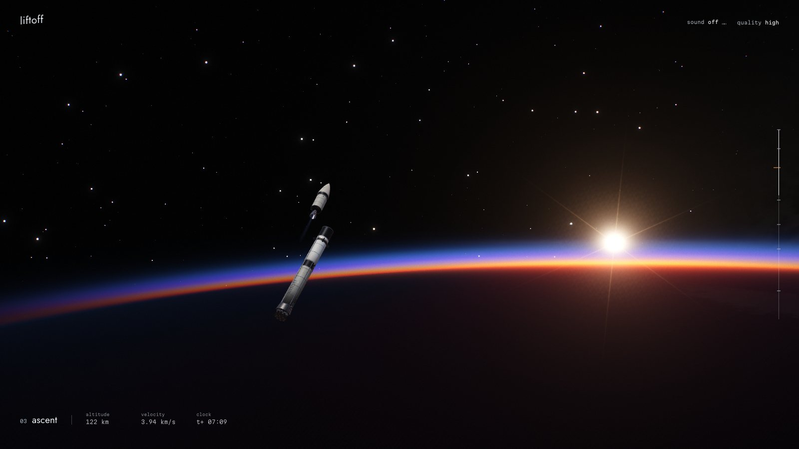

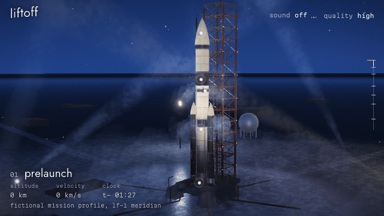

Every frame above and below is a real capture from the running site.

| | | |
|---|---|---|
| 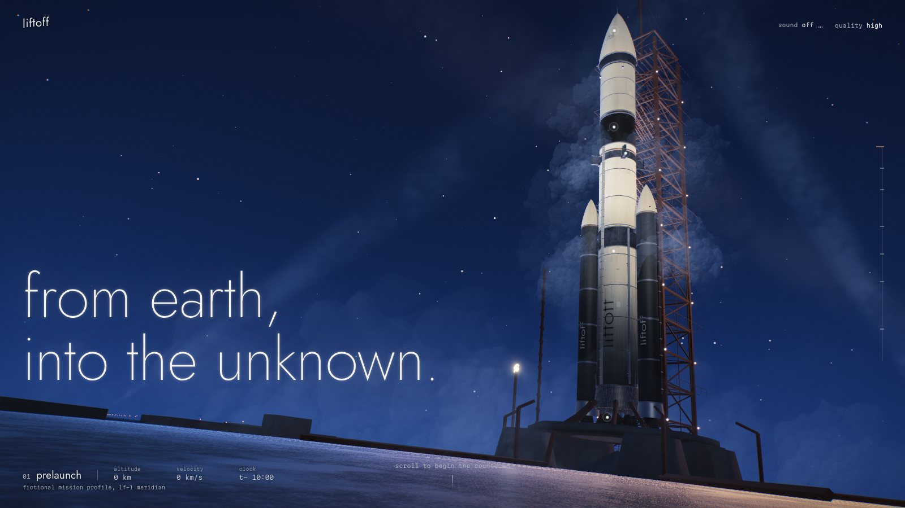 | 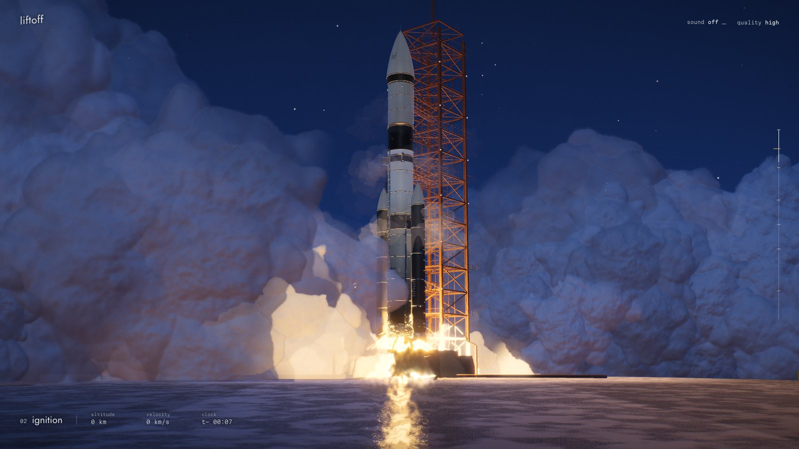 | 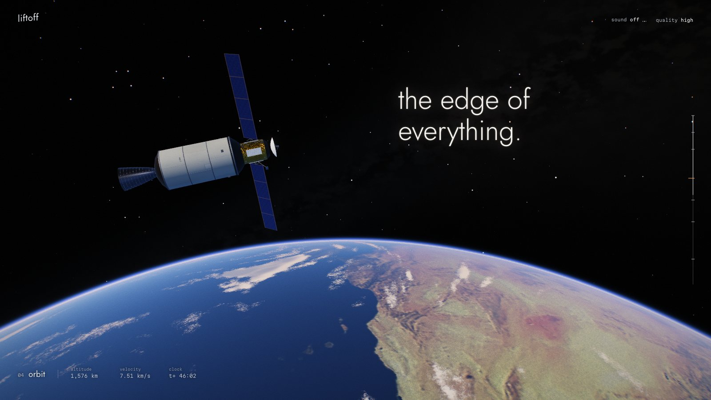 |
| 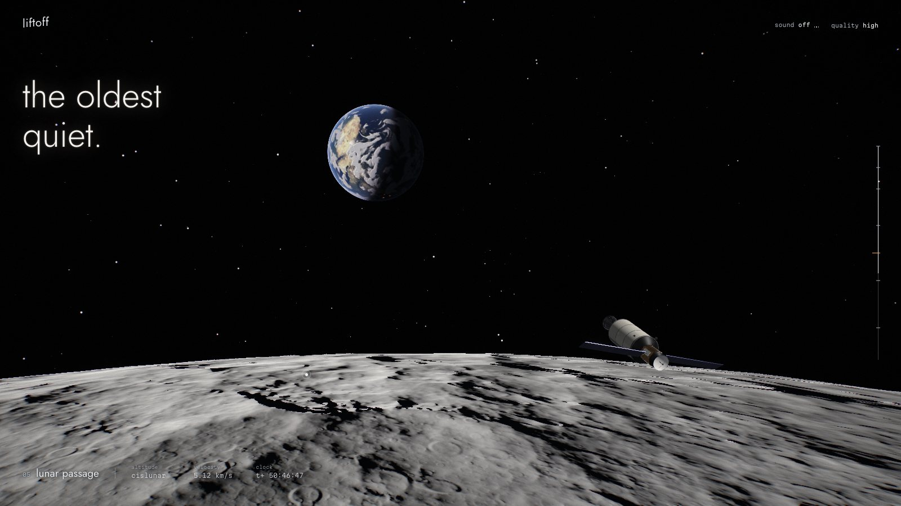 | 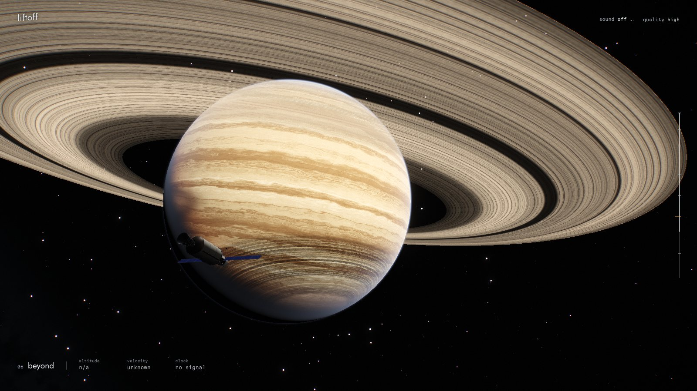 | 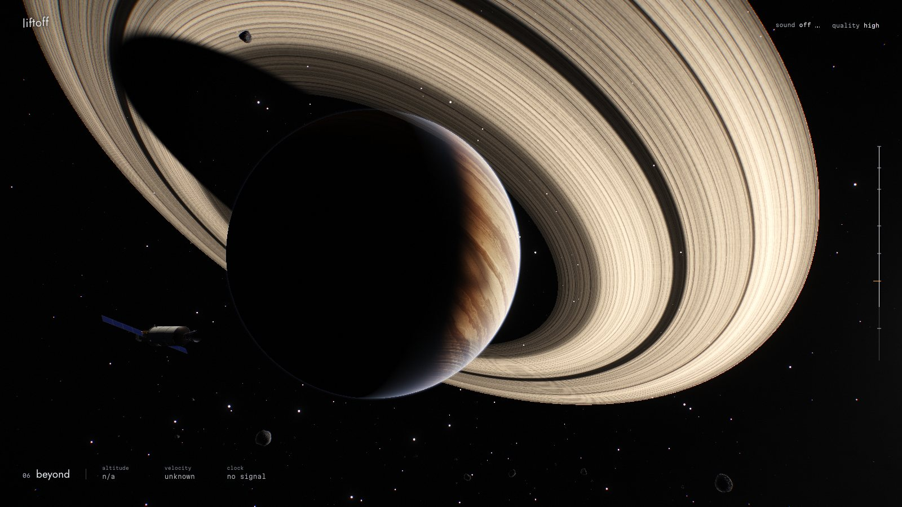 |
| 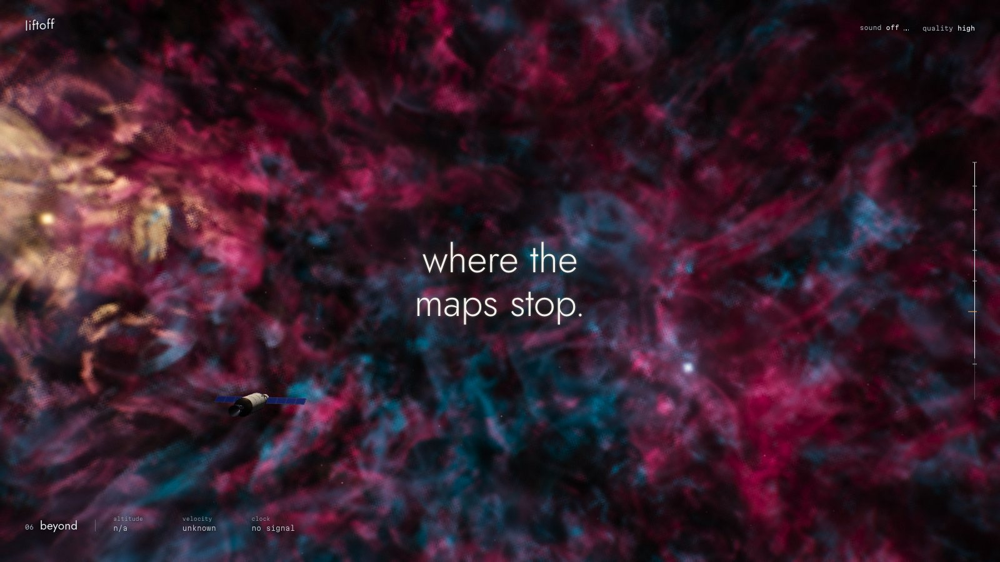 | 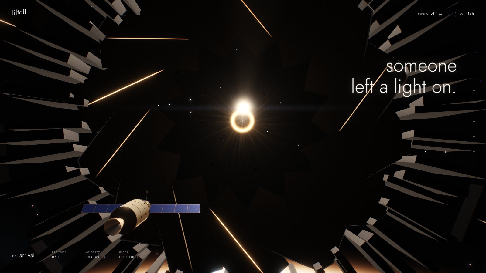 | 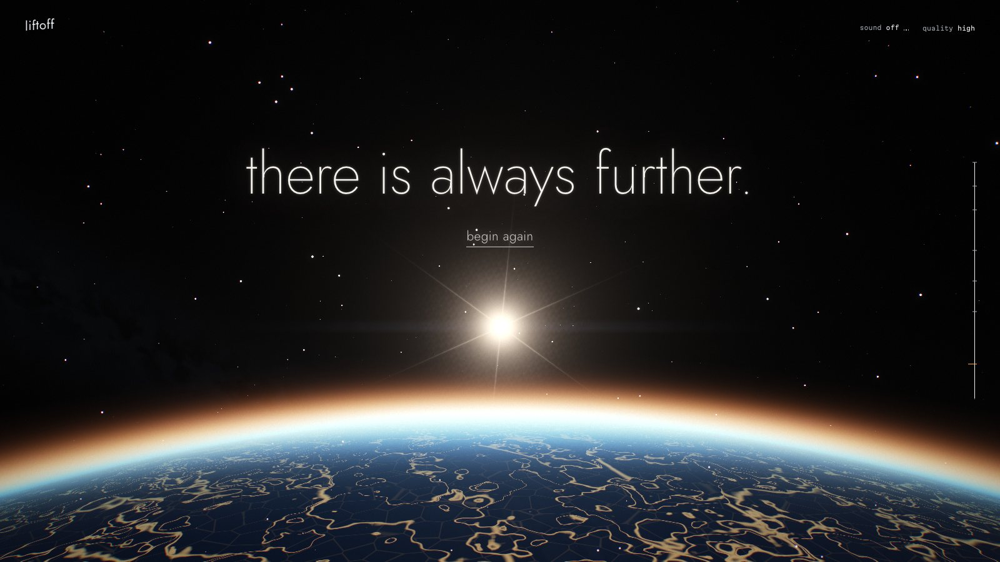 |

## The seven chapters

1. **prelaunch**: blue hour. A low-angle hero shot of the vehicle under crossing searchlights, cold vapor sinking down its tanks; the camera climbs it, then pulls back.
2. **ignition**: the floodlights dim, the chambers glow, and fire and smoke take over the pad.
3. **ascent**: long-lens coverage from far down the coast, a dolly zoom up to the vehicle, its two boosters falling away, then over the curve of the Earth into sunrise.
4. **orbit**: the first stage falls away, the fairing opens, and a gold-foil probe unfolds its wings as the Atlantic gives way to the coast of West Africa.
5. **lunar passage**: the camera swings right around the probe, from a shrinking Earth to a growing Moon, then a low pass over the cratered terminator as Earth rises over the limb.
6. **beyond**: an asteroid field, a ringed giant seen from both sides of its ring plane, an eclipse, a nebula lit from within.
7. **arrival**: black slabs and a deep colonnade unfold around an aperture that lights them from within and burns to white. Then a sunrise on a new world: *there is always further.* And a way to begin again.

## Interaction

- **Scroll** is time. It works in both directions and at any speed.
- **Chapter rail**, or the left and right arrow keys, to jump. Chapter links are real URLs (`/#orbit`) and browser back and forward follow them.
- **Rocket hotspots**: hover or tab to a dot for an annotation; click to ease the lens towards it.
- **Earth**: hover for the true latitude and longitude under the cursor, click to focus.
- **Lunar hotspot**: opens a close-up inset, the same terrain rendered through a long lens.
- **The giant**: hover for a note, click to focus.
- **Nebula**: dust motes shy away from the cursor.
- **The gate**: click the aperture to enter.
- **Sound** (off by default) and **quality** (auto, or low, balanced, high, ultra) are in the top corner.

Clicks never change your place in the film, and a focus releases as soon as you scroll. All controls work by keyboard.

## Technology

JavaScript only. React, Vite, Three.js, React Three Fiber, Drei (`PerformanceMonitor`), GSAP with ScrollTrigger, ScrollToPlugin and `useGSAP`, custom GLSL, Zustand, Vitest, Playwright.

## How it works

### One deterministic timeline

There's one number, `progress`, from 0 to 1. A single paused GSAP timeline with a duration of exactly 1 tweens about 40 numeric channels on a plain object (thrust, staging, exposure, travel, and so on), each written as explicit `fromTo` segments so that seeking gives the same values from any direction. ScrollTrigger scrubs it. A pure function, `computeFrame(track, progress, aspect)`, turns channels into the camera, the vehicle and the position of everything in the solar system. It never reads the previous frame, so reversing, jumping, reloading and resizing are all the same operation. Unit tests sample the path 4000 times per aspect ratio and fail on any teleport or sudden rotation; that test caught several real bugs during development.

Particles are stateless too. A smoke puff's position is a closed-form function of `now - birth`, so scrubbing backwards unburns the fuel.

### Shots, not keyframes

The camera is a shot list (`src/camera/SplinePaths.js`) with overlapping windows that dissolve into each other. Close to the ground, shots are centripetal Catmull-Rom splines. In space they are *composed*: a shot says where the limb should sit and where on screen the vehicle should land, and the camera position is solved from that. The same composition then holds at any altitude and aspect ratio. Narrow screens keep vertical subjects close, pull back from horizontal ones and recentre anything that was off-centre to make room for type.

### Two scales in one frame

A rocket is 78 metres long and Earth is 12,700 kilometres across. Each frame is rendered in two layers into one HDR target: a far "cosmos" pass in kilometres, drawn back to front with no depth buffer, then a near pass in metres over a cleared depth buffer. Both share the same camera rotation.

### Graphics

- **One atmosphere, pad to space.** Earth is not a mesh. It's ray traced per pixel as a true sphere, using a stable quadratic so it stays precise a few metres above the ground. Surface, clouds, cloud shadows, night lights, ocean glint and single-scattering air with ozone absorption are one calculation, importance-sampled along each ray. The sky at the launchpad and the thin blue line seen from orbit are the same shader, which is why there's no cut between them. The launch is pre-dawn, so the sun crests the limb just as the sky turns black.
- **Colour script**: each chapter is graded on its own, as a pure function of progress: blue hour against fire, neutral black in orbit, charcoal monochrome at the Moon, warm ivory at the giant, saturated gas in the nebula, copper at the end (`src/experience/Grade.js`).
- **Earth detail**: relief lit from the map's own brightness, sub-map surface texture, frayed cloud edges and broken ocean glint, so it never reads as a blurred photo.
- **Moon**: relief-marched crust with self-shadowing over NASA elevation and a baked crater tile, with regolith held to a dark albedo, so the horizon is jagged and the ground reads as charcoal rather than snow.
- **Ringed giant**: planet, rings and their mutual shadows ray traced together, so occlusion is exact from either side of the ring plane. Weather is sampled in stretched lon/lat coordinates with irregular zones and one swirled oval storm; rings carry ringlets that fade out before they can alias.
- **Asteroids**: spheres cut by random planes, so they have flat fractured faces and hard silhouettes, then ridged noise, craters and per-vertex occlusion on top.
- **Nebula**: a domain-warped volume march at reduced resolution. Rounded ridged noise forms filaments and walls, dust stands in front as silhouettes, and one shadow tap per step gives each wall a lit and a dark side.
- **Exhaust**: a short volumetric march through a density field with turbulence, shock diamonds and vacuum expansion, so it holds up from any angle.
- **Destination**: instanced black slabs and thin fins, lit from inside by the aperture once it opens, around a streaming body of light, over a basalt world with a second set of atmospheric gases.
- **Launch site**: one continuous ground surface, a mound rather than a slab, with the rocket and tower mirrored analytically in the wet concrete. Searchlights are real shadow-casting lights with visible beams through drifting mist.
- **Smoke**: a baked atlas of cauliflower billows, each a true height field of nested sphere caps, lit orange close to the flame and blue everywhere else.
- **Post**: a dual-filter HDR bloom chain with a soft knee and warm halation, radial light shafts, an anamorphic streak, a restrained aperture flare whose occlusion is computed from the actual bodies in the way, heat shimmer, slight lens fringing, filmic curve, vignette and grain.
- **The rocket**: `lf-1 meridian`, an original fictional heavy-lift vehicle generated in code (`src/objects/rocket/`). Two strap-on boosters, nine engines with plumbing and gimbal actuators, a corrugated intertank, ring frames, raceways, feed lines, umbilical plates and an interstage hiding a vacuum nozzle. Skin is painted at load in matched layers: albedo with plate tone, frost and soot, roughness and metalness, and a height field differentiated into a true normal map. Each region of the flight gets its own baked reflection environment, so the gold foil really does reflect a blue planet.
- **Type**: two sizes only. Lines arrive the way a lens finds focus, out of a soft blur with spacing settling, and halate slightly like white letters on a print. Scrubbed by the same mapping as the picture.
- **Sound**: entirely synthesised in Web Audio, driven by the same channels as the picture.

### Performance

- Everything is warmed before the curtain lifts: shaders compile and link, textures upload, render targets allocate and all geometry is drawn once into a tiny target, so no chapter stalls on first appearance. Lights stay in the scene at zero intensity rather than being hidden, because changing the light count relinks every lit material mid-flight.
- Assets load by stage with true byte progress. Textures are WebP (about 1.9 MB in total); later chapters load in the background, unless you reload into one.
- Quality is a data table of step counts and draw ranges. Changing tier never rebuilds geometry or recompiles a shader. Automatic mode starts from a guess and steps by measured frame rate; it never picks ultra by itself.

Measured with `npm run measure`, which forces each frame to finish with a pixel readback. Median frame interval on one machine, an Apple M4 Pro laptop in Chromium at a 1440 x 900 window, on a 60 Hz display (so 16.7 ms is the floor, not the true cost):

| tier | render size | worst chapter | everywhere else |
|---|---|---|---|
| low | 1440 x 900 | 17.5 ms | about 17 ms |
| balanced | 1800 x 1125 | 16.9 ms | about 17 ms |
| high | 2160 x 1350 | 16.9 ms | about 17 ms |
| ultra | 2880 x 1800 | 26.8 ms (ignition) | about 17 ms |

`node scripts/measure-scrub.mjs <url> <tier> <seconds>` measures pacing during a real scroll down the whole film and back, again with a readback each frame. Over 60 seconds, high and balanced both gave a median of 16.7 ms, a 99th percentile under 20 ms, a worst frame near 31 ms, and no main-thread long tasks. A faster 40-second run once showed a single stray frame of 146 ms that did not recur at slower speed; the cause was not identified.

That's the only hardware measured. Expect much less on integrated or older GPUs, which is what the lower tiers are for.

### Accessibility

`prefers-reduced-motion` gets a different presentation: seven held frames with short fades, written descriptions, no camera movement and no animated shaders. Everything is reachable by keyboard, with visible focus and a screen-reader chapter list. Sound never starts without a gesture. Without WebGL 2 you get the film's real stills.

## Assets and licences

| Asset | Source | Status |
|---|---|---|
| Earth day map | [Blue Marble: land surface, shallow water and shaded topography](https://commons.wikimedia.org/wiki/File:Whole_world_-_land_and_oceans_12000.jpg), NASA Goddard Space Flight Center, via Wikimedia Commons | Public domain |
| Earth night lights | [Black Marble 2012](https://assets.science.nasa.gov/content/dam/science/esd/eo/images/imagerecords/79000/79765/dnb_land_ocean_ice.2012.3600x1800.jpg), NASA Earth Observatory | NASA media, [guidelines](https://www.nasa.gov/nasa-brand-center/images-and-media/) |
| Moon colour and elevation | [CGI Moon Kit](https://svs.gsfc.nasa.gov/4720/), NASA Scientific Visualization Studio | NASA media, same guidelines |
| Ocean mask | Derived here from the Earth day map | Derived |
| Clouds, crater tile, smoke atlas | Generated by `scripts/bake-procedural.mjs` | Original, not real weather data |
| Rocket, launch site, asteroids, giant, nebula, destination, sound | Generated in code | Original |
| Jost, Martian Mono | Via Fontsource | SIL Open Font License |

NASA's guidelines say its material, including texture maps, is generally not subject to US copyright. NASA does not endorse this project. The launch site sits on the real Florida coast, so the geography under the flight is accurate, but the vehicle, mission profile and every number on screen are fictional, and the interface says so.

## Local development

Requires Node 22.12 or newer.

```bash
npm install
```

```bash
npm run dev
```

Useful URL parameters: `?p=0.47` holds a frame at that progress, `?tier=high` forces a quality tier, `?reduced` forces the reduced-motion presentation, `?nowebgl` shows the fallback.

The textures are committed. `npm run assets` rebakes the procedural maps; pass a folder of downloaded NASA images to `node scripts/prepare-textures.mjs <dir>` to reconvert the rest.

## Testing

```bash
npm test
```

Unit tests cover timeline determinism from any route, camera continuity at wide and phone aspect ratios, the mission profile, quality logic and the brand rules.

```bash
npx playwright install chromium
```

```bash
npm run test:e2e
```

Browser tests run against the production build with a real GPU context: every stop reading identically on the way forward and back, a fast real scroll down and up restoring the titles, wheel scrolling both ways, every chapter rendering a non-blank frame, reload at a saved position, resize, deep links, back and forward, begin again, sound gating, hotspots, the crater inset, the gate, reduced motion, the WebGL fallback and phone layout. Set `BASE_URL` to run them against a deployed site.

## Deployment

Hosted on Vercel, deployed with the CLI. Pushing to git doesn't deploy.

```bash
npx vercel deploy --prod --yes --scope max-76fd
```

## Known limitations

- Sound has been checked in code only: nobody has listened to it yet, so its balance may need tuning by ear.
- Tested in Chromium on one Apple Silicon Mac, and in emulated phone viewports. Safari, Firefox, real phones and displays above 60 Hz are untested.
- Texture compression is WebP rather than KTX2, because the tooling wasn't available. Close to the ground, Earth's textures are soft; the launch site's near-field geometry and haze cover that.
- Smoke isn't a fluid simulation, and its particles aren't depth-sorted.
- Cloud patterns are procedural, so they don't match real weather.
